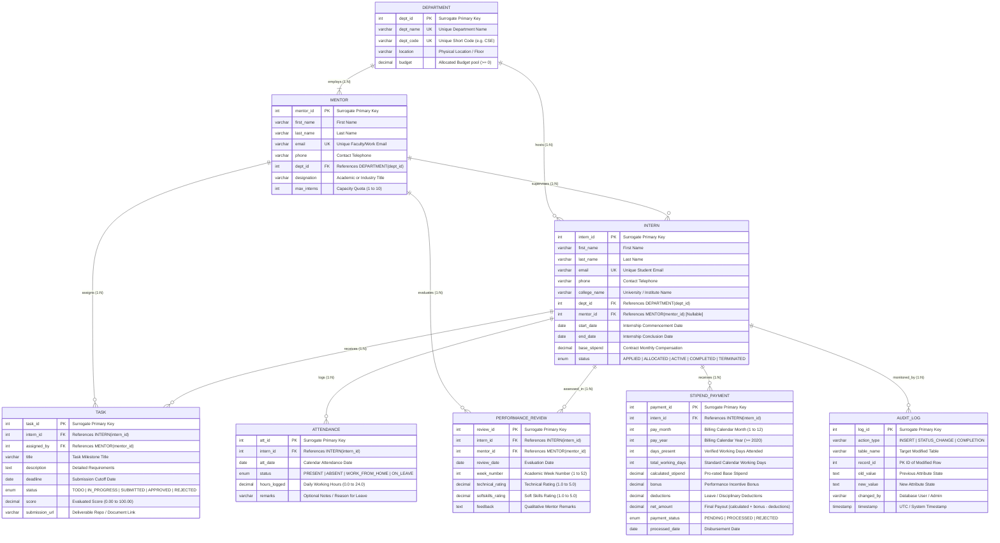

# InternHub: Comprehensive Entity-Relationship (ER) Model
## Course: CS203 Database Management Systems — SVNIT Surat
### Team: `sandpaper`

---

## 1. Crow's Foot Relational ER Diagram

---

## 2. Cardinality & Participation Constraints Table

| Entity 1 | Relationship | Entity 2 | Cardinality | Participation (Entity 1) | Participation (Entity 2) | Structural Rationale |
| :--- | :---: | :--- | :---: | :---: | :---: | :--- |
| **DEPARTMENT** | *employs* | **MENTOR** | $1 : N$ | Partial | Total | A department can have multiple mentors ($N \ge 0$). Every mentor must belong to exactly one department. |
| **DEPARTMENT** | *hosts* | **INTERN** | $1 : N$ | Partial | Total | An academic department hosts multiple interns. Every intern belongs to a host department. |
| **MENTOR** | *supervises* | **INTERN** | $1 : N$ | Partial | Partial | A mentor guides $0$ to `max_interns` (capped by trigger). An intern has at most one primary supervisor (nullable when initially `APPLIED`). |
| **MENTOR** | *assigns* | **TASK** | $1 : N$ | Partial | Total | A mentor assigns several project milestones. Every task is created by a mentor. |
| **INTERN** | *undertakes* | **TASK** | $1 : N$ | Partial | Total | An intern is assigned multiple tasks. Each task belongs strictly to one intern. |
| **INTERN** | *logs* | **ATTENDANCE** | $1 : N$ | Partial | Total | An intern logs attendance each working day. Every record belongs to an intern; unique per date via `UNIQUE(intern_id, att_date)`. |
| **MENTOR** | *conducts* | **PERFORMANCE_REVIEW** | $1 : N$ | Partial | Total | Mentors evaluate assigned students weekly. Every review is authored by a mentor. |
| **INTERN** | *receives* | **PERFORMANCE_REVIEW** | $1 : N$ | Partial | Total | An intern receives weekly evaluations; unique per week via `UNIQUE(intern_id, week_number)`. |
| **INTERN** | *earns* | **STIPEND_PAYMENT** | $1 : N$ | Partial | Total | An intern is issued monthly payroll statements computed via MySQL Cursor; unique per month via `UNIQUE(intern_id, pay_month, pay_year)`. |
| **INTERN** | *audited_in* | **AUDIT_LOG** | $1 : N$ | Partial | Total | Intern state transitions (`APPLIED` $\rightarrow$ `ACTIVE` $\rightarrow$ `COMPLETED`) automatically log audit trails. |

---

## 3. Attribute Taxonomy (Chen's Notation Breakdown)

### A. Key Attributes (Primary & Candidate Keys)
- `dept_id`, `dept_name`, `dept_code` in `DEPARTMENT`
- `mentor_id`, `email` in `MENTOR`
- `intern_id`, `email` in `INTERN`
- `task_id` in `TASK`
- `att_id` and composite `(intern_id, att_date)` in `ATTENDANCE`
- `review_id` and composite `(intern_id, week_number)` in `PERFORMANCE_REVIEW`
- `payment_id` and composite `(intern_id, pay_month, pay_year)` in `STIPEND_PAYMENT`
- `log_id` in `AUDIT_LOG`

### B. Composite Attributes
- Intern & Mentor full names: decomposed into `first_name` and `last_name` to uphold **1NF (Atomic Attributes)**.
- Attendance composite natural key: `(intern_id, att_date)`.
- Evaluation composite natural key: `(intern_id, week_number)`.
- Payroll billing cycle composite key: `(intern_id, pay_month, pay_year)`.

### C. Derived Attributes (Computed via Stored Programs / Functions)
- **`composite_performance_score`**: Calculated on the fly via `fn_calculate_overall_score(intern_id)`:
  $$\text{Composite Score} = (0.60 \times \text{Avg Task Score}) + (0.40 \times \text{Avg Mentor Rating} \times 20)$$
- **`attendance_rate`**: Calculated via `fn_calculate_attendance_rate(intern_id, month, year)`:
  $$\text{Attendance Rate} = \left(\frac{\text{Present Days}}{\text{Total Logged Days}}\right) \times 100$$
- **`slots_available` & `utilization_pct`**: Derived dynamically in view `vw_mentor_workload`:
  $$\text{Slots Available} = \text{max\_interns} - \text{current\_active\_interns}$$

---

## 4. Referential Integrity & Foreign Key Actions

| Foreign Key | Parent Table | Child Table | ON DELETE | ON UPDATE | Justification |
| :--- | :--- | :--- | :---: | :---: | :--- |
| `dept_id` | `departments` | `mentors` | `RESTRICT` | `CASCADE` | Prevents deleting a department if faculty mentors are currently attached. |
| `dept_id` | `departments` | `interns` | `RESTRICT` | `CASCADE` | Protects institutional record integrity. |
| `mentor_id` | `mentors` | `interns` | `SET NULL` | `CASCADE` | If a mentor leaves, interns remain active and are reassigned rather than deleted. |
| `intern_id` | `interns` | `tasks` | `CASCADE` | `CASCADE` | Deleting a test intern cleans up their associated task records. |
| `intern_id` | `interns` | `attendance` | `CASCADE` | `CASCADE` | Prevents orphaned attendance rows. |
| `intern_id` | `interns` | `performance_reviews`| `CASCADE` | `CASCADE` | Prevents orphaned review rows. |
| `intern_id` | `interns` | `stipend_payments` | `CASCADE` | `CASCADE` | Prevents orphaned disbursement rows. |
