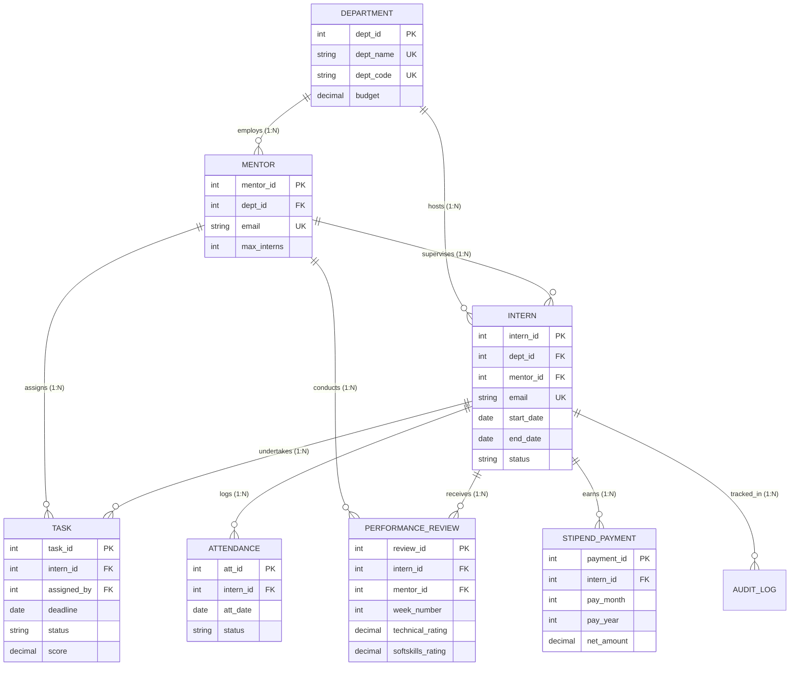

# SVNIT Surat — Department of Computer Science and Engineering
## CS203: Database Management Systems (B.Tech. II CSE, Semester-III)
### Academic Year: 2026-27

---

# DATABASE PROJECT REPORT
## **InternHub: Comprehensive Internship & Mentor Management System**

**Team Name:** `sandpaper`  
**Course Code & Title:** CS203 — Database Management Systems  
**Institute:** Sardar Vallabhbhai National Institute of Technology (SVNIT), Surat  
**Database Engine:** MySQL 8.0+ / MySQL Workbench  
**Application Interface:** Python / Streamlit Full-Stack Architecture  

---

## TABLE OF CONTENTS
1. [Phase A: Project Requirements & System Analysis](#phase-a-project-requirements--system-analysis)
2. [Phase B: Conceptual Design (ER Model)](#phase-b-conceptual-design-er-model)
3. [Phase C: Logical Design & Normalization (Up to BCNF)](#phase-c-logical-design--normalization-up-to-bcnf)
4. [Phase D: Physical Design & Procedural Programs](#phase-d-physical-design--procedural-programs)
5. [Phase E: Prototype, Development & Testing](#phase-e-prototype-development--testing)
6. [Phase F: Project Presentation, Demonstration & Viva Guide](#phase-f-project-presentation-demonstration--viva-guide)

---

## Phase A: Project Requirements & System Analysis

### 1.1 Problem Statement & Background Context
In modern academic institutions and enterprise incubation centres, handling internship programs involves orchestrating multiple departments, supervising faculty mentors, tracking daily deliverables, conducting weekly milestone evaluations, and computing pro-rated stipend payments.

Traditional spreadsheet-driven or ad-hoc workflows suffer from critical vulnerabilities:
1. **Mentor Over-allocation:** Mentors get assigned more interns than their bandwidth allows, degrading research guidance quality.
2. **Evaluation Inconsistency:** Qualitative remarks are scattered without systematic normalization or composite performance formulas.
3. **Disbursement Computation Errors:** Calculating pro-rated monthly stipends from calendar attendance, leave policies, and merit bonuses manually leads to financial discrepancies.
4. **Lack of Audit Accountability:** Changes in intern status (e.g. from `APPLIED` to `ACTIVE` or `COMPLETED`) lack non-repudiable audit logs.

### 1.2 Objectives
The **InternHub** system was engineered to deliver an integrated, relational DBMS solution ensuring ACID transactional compliance, strict constraint checking at the database engine level, and automated procedural workflows.

### 1.3 Stakeholder Roles & Task Breakdown
The system supports three primary user roles:

| User Role | Responsibilities & Capabilities |
| :--- | :--- |
| **Admin / HR Officer** | • Register departments and allocate budgetary pools.<br>• Onboard new student interns atomically using stored procedures.<br>• Oversee mentor allocations and monitor capacity utilization.<br>• Execute batch monthly stipend disbursement routines using cursors.<br>• Inspect system audit logs for security compliance. |
| **Faculty Mentor** | • Monitor supervised interns (capped by a strict capacity trigger).<br>• Create project tasks with deadlines.<br>• Review submitted work and grade approved milestones (0–100 scale).<br>• Submit weekly performance reviews (technical and soft skills on 1.0–5.0 scale). |
| **Student Intern** | • View assigned departmental mentor, start/end dates, and base stipend.<br>• Log daily attendance (`PRESENT`, `WORK_FROM_HOME`, `ON_LEAVE`, `ABSENT`).<br>• View pending tasks and upload submission links.<br>• Track monthly calculated stipend slips and composite performance ratings. |

---

## Phase B: Conceptual Design (ER Model)

### 2.1 Entity Identification & Minimal Attributes
To eliminate redundancy and uphold relational purity, the domain is decomposed into 8 minimal entities:

1. **`DEPARTMENT`**:
   - Primary Identifier: `dept_id`
   - Attributes: `dept_name` (Unique), `dept_code` (Unique), `location`, `budget`
2. **`MENTOR`**:
   - Primary Identifier: `mentor_id`
   - Attributes: `first_name`, `last_name`, `email` (Unique), `phone`, `dept_id` (FK), `designation`, `max_interns`
3. **`INTERN`**:
   - Primary Identifier: `intern_id`
   - Attributes: `first_name`, `last_name`, `email` (Unique), `phone`, `college_name`, `dept_id` (FK), `mentor_id` (FK, Nullable), `start_date`, `end_date`, `base_stipend`, `status`
4. **`TASK`**:
   - Primary Identifier: `task_id`
   - Attributes: `intern_id` (FK), `assigned_by` (FK to Mentor), `title`, `description`, `deadline`, `status`, `score`, `submission_url`
5. **`ATTENDANCE`**:
   - Primary Identifier: `att_id`
   - Attributes: `intern_id` (FK), `att_date`, `status`, `hours_logged`, `remarks`
   - Composite Unique Key: `(intern_id, att_date)`
6. **`PERFORMANCE_REVIEW`**:
   - Primary Identifier: `review_id`
   - Attributes: `intern_id` (FK), `mentor_id` (FK), `review_date`, `week_number`, `technical_rating`, `softskills_rating`, `feedback`
   - Composite Unique Key: `(intern_id, week_number)`
7. **`STIPEND_PAYMENT`**:
   - Primary Identifier: `payment_id`
   - Attributes: `intern_id` (FK), `pay_month`, `pay_year`, `days_present`, `total_working_days`, `calculated_stipend`, `bonus`, `deductions`, `net_amount`, `payment_status`, `processed_date`
   - Composite Unique Key: `(intern_id, pay_month, pay_year)`
8. **`AUDIT_LOG`**:
   - Primary Identifier: `log_id`
   - Attributes: `action_type`, `table_name`, `record_id`, `old_value`, `new_value`, `changed_by`, `timestamp`
9. **`USERS`**:
   - Primary Identifier: `user_id`
   - Attributes: `email` (Unique), `password_hash`, `role` (`ADMIN`, `MENTOR`, `INTERN`, `EVALUATOR`), `reference_id` (FK to Mentor/Intern), `full_name`, `is_active`, `created_at`

### 2.2 Entity-Relationship (ER) Diagram


### 2.3 Cardinalities & Structural Constraints
- **Department to Mentor ($1 : N$)**: A department employs multiple faculty mentors ($N \ge 0$). Each mentor belongs to exactly one department (Total participation).
- **Mentor to Intern ($1 : N$)**: A mentor supervises between 0 and `max_interns` (default 3, enforced via trigger). An intern is guided by at most one mentor at any given point in time.
- **Intern to Task ($1 : N$)**: An intern has zero or more assigned deliverables. Each task is tied to one specific intern and assigned by one mentor.
- **Intern to Attendance ($1 : N$)**: An intern records at most one attendance entry per calendar day via `UNIQUE(intern_id, att_date)`.
- **Intern to Weekly Review ($1 : N$)**: A mentor evaluates an intern at most once per week via `UNIQUE(intern_id, week_number)`.
- **Intern to Stipend Payment ($1 : N$)**: An intern has at most one payroll disbursement record per calendar month via `UNIQUE(intern_id, pay_month, pay_year)`.

---

## Phase C: Logical Design & Normalization (Up to BCNF)

### 3.1 Mapping to Relational Schema
The conceptual ER model maps directly into the following relational database schema:
1. `departments` (`dept_id`, `dept_name`, `dept_code`, `location`, `budget`, `created_at`)
2. `mentors` (`mentor_id`, `first_name`, `last_name`, `email`, `phone`, `dept_id`, `designation`, `max_interns`, `created_at`)
3. `interns` (`intern_id`, `first_name`, `last_name`, `email`, `phone`, `college_name`, `dept_id`, `mentor_id`, `start_date`, `end_date`, `base_stipend`, `status`, `created_at`)
4. `tasks` (`task_id`, `intern_id`, `assigned_by`, `title`, `description`, `deadline`, `status`, `score`, `submission_url`, `created_at`)
5. `attendance` (`att_id`, `intern_id`, `att_date`, `status`, `hours_logged`, `remarks`, `created_at`)
6. `performance_reviews` (`review_id`, `intern_id`, `mentor_id`, `review_date`, `week_number`, `technical_rating`, `softskills_rating`, `feedback`, `created_at`)
7. `stipend_payments` (`payment_id`, `intern_id`, `pay_month`, `pay_year`, `days_present`, `total_working_days`, `calculated_stipend`, `bonus`, `deductions`, `net_amount`, `payment_status`, `processed_date`, `created_at`)
8. `audit_logs` (`log_id`, `action_type`, `table_name`, `record_id`, `old_value`, `new_value`, `changed_by`, `timestamp`)
9. `users` (`user_id`, `email`, `password_hash`, `role`, `reference_id`, `full_name`, `is_active`, `created_at`)

---

### 3.2 Functional Dependencies (FDs) Analysis

Let us analyze each relation's Functional Dependencies:

#### 1. Relation: `departments`
- $FD_1: \text{dept\_id} \rightarrow \{\text{dept\_name}, \text{dept\_code}, \text{location}, \text{budget}\}$
- $FD_2: \text{dept\_name} \rightarrow \{\text{dept\_id}, \text{dept\_code}, \text{location}, \text{budget}\}$
- $FD_3: \text{dept\_code} \rightarrow \{\text{dept\_id}, \text{dept\_name}, \text{location}, \text{budget}\}$
- **Candidate Keys:** $\{\text{dept\_id}\}, \{\text{dept\_name}\}, \{\text{dept\_code}\}$

#### 2. Relation: `mentors`
- $FD_1: \text{mentor\_id} \rightarrow \{\text{first\_name}, \text{last\_name}, \text{email}, \text{phone}, \text{dept\_id}, \text{designation}, \text{max\_interns}\}$
- $FD_2: \text{email} \rightarrow \{\text{mentor\_id}, \text{first\_name}, \text{last\_name}, \text{phone}, \text{dept\_id}, \text{designation}, \text{max\_interns}\}$
- **Candidate Keys:** $\{\text{mentor\_id}\}, \{\text{email}\}$

#### 3. Relation: `interns`
- $FD_1: \text{intern\_id} \rightarrow \{\text{first\_name}, \text{last\_name}, \text{email}, \text{phone}, \text{college\_name}, \text{dept\_id}, \text{mentor\_id}, \text{start\_date}, \text{end\_date}, \text{base\_stipend}, \text{status}\}$
- $FD_2: \text{email} \rightarrow \{\text{intern\_id}, \text{first\_name}, \dots, \text{status}\}$
- **Candidate Keys:** $\{\text{intern\_id}\}, \{\text{email}\}$

#### 4. Relation: `tasks`
- $FD_1: \text{task\_id} \rightarrow \{\text{intern\_id}, \text{assigned\_by}, \text{title}, \text{description}, \text{deadline}, \text{status}, \text{score}, \text{submission\_url}\}$
- **Candidate Key:** $\{\text{task\_id}\}$

#### 5. Relation: `attendance`
- $FD_1: \text{att\_id} \rightarrow \{\text{intern\_id}, \text{att\_date}, \text{status}, \text{hours\_logged}, \text{remarks}\}$
- $FD_2: \{\text{intern\_id}, \text{att\_date}\} \rightarrow \{\text{att\_id}, \text{status}, \text{hours\_logged}, \text{remarks}\}$
- **Candidate Keys:** $\{\text{att\_id}\}, \{\text{intern\_id}, \text{att\_date}\}$

#### 6. Relation: `performance_reviews`
- $FD_1: \text{review\_id} \rightarrow \{\text{intern\_id}, \text{mentor\_id}, \text{review\_date}, \text{week\_number}, \text{technical\_rating}, \text{softskills\_rating}, \text{feedback}\}$
- $FD_2: \{\text{intern\_id}, \text{week\_number}\} \rightarrow \{\text{review\_id}, \text{mentor\_id}, \text{review\_date}, \text{technical\_rating}, \text{softskills\_rating}, \text{feedback}\}$
- **Candidate Keys:** $\{\text{review\_id}\}, \{\text{intern\_id}, \text{week\_number}\}$

#### 7. Relation: `stipend_payments`
- $FD_1: \text{payment\_id} \rightarrow \{\text{intern\_id}, \text{pay\_month}, \text{pay\_year}, \text{days\_present}, \text{total\_working\_days}, \text{calculated\_stipend}, \text{bonus}, \text{deductions}, \text{net\_amount}, \text{payment\_status}, \text{processed\_date}\}$
- $FD_2: \{\text{intern\_id}, \text{pay\_month}, \text{pay\_year}\} \rightarrow \{\text{payment\_id}, \dots, \text{processed\_date}\}$
- **Candidate Keys:** $\{\text{payment\_id}\}, \{\text{intern\_id}, \text{pay\_month}, \text{pay\_year}\}$

#### 8. Relation: `users`
- $FD_1: \text{user\_id} \rightarrow \{\text{email}, \text{password\_hash}, \text{role}, \text{reference\_id}, \text{full\_name}, \text{is\_active}, \text{created\_at}\}$
- $FD_2: \text{email} \rightarrow \{\text{user\_id}, \text{password\_hash}, \text{role}, \text{reference\_id}, \text{full\_name}, \text{is\_active}, \text{created\_at}\}$
- **Candidate Keys:** $\{\text{user\_id}\}, \{\text{email}\}$ (Determinants are superkeys $\rightarrow$ in BCNF)

---

### 3.3 Proof of Normalization (1NF, 2NF, 3NF, and BCNF)

#### Step 1: First Normal Form (1NF)
A relation $R$ is in 1NF if and only if all attribute values are atomic (indivisible) and no multivalued attributes or repeating groups exist.
- *Verification:* Attributes such as phone numbers, dates, scores, and names are atomic scalar data types. Each row represents a single atomic tuple.

#### Step 2: Second Normal Form (2NF)
A relation $R$ is in 2NF if and only if it is in 1NF and no non-prime attribute is partially dependent on any candidate key (no partial functional dependency).
- *Verification:*
  - In `attendance`, candidate key is $\{\text{intern\_id}, \text{att\_date}\}$. Attributes `status` and `hours_logged` depend on both `intern_id` AND `att_date`, not on `intern_id` alone.
  - In `performance_reviews`, candidate key is $\{\text{intern_id}, \text{week_number}\}$. The ratings depend on the combination of the intern and the specific week evaluated.
  - In all other relations, candidate keys are single attributes (`dept_id`, `mentor_id`, `intern_id`, `task_id`, `payment_id`). Therefore, partial dependencies are mathematically impossible.
  - Hence, the schema is strictly in **2NF**.

#### Step 3: Third Normal Form (3NF)
A relation $R$ is in 3NF if and only if whenever a non-trivial functional dependency $X \rightarrow Y$ holds in $R$, either:
1. $X$ is a superkey of $R$, OR
2. $Y$ is a prime attribute (part of a candidate key).
- *Verification:* In all eight tables, there are no transitive dependencies of the form $X \rightarrow Z$ through an intermediate non-key attribute $Y$. Department names and locations are separated into `departments`, rather than stored in `interns` or `mentors`. Hence, all non-key attributes depend directly and only on candidate keys.
- Hence, the schema is in **3NF**.

#### Step 4: Boyce-Codd Normal Form (BCNF)
A relation $R$ is in BCNF if and only if for every non-trivial functional dependency $X \rightarrow Y$ in $R$, $X$ is a **superkey**.
- *Verification:*
  - In `departments`, the determinants are `dept_id`, `dept_name`, and `dept_code`. All three are candidate keys (superkeys).
  - In `mentors`, the determinants are `mentor_id` and `email`. Both are candidate keys.
  - In `interns`, the determinants are `intern_id` and `email`. Both are candidate keys.
  - In `attendance`, the determinants are `att_id` and $\{\text{intern_id}, \text{att_date}\}$. Both are candidate keys.
  - In `performance_reviews`, the determinants are `review_id` and $\{\text{intern_id}, \text{week_number}\}$. Both are candidate keys.
  - In `stipend_payments`, the determinants are `payment_id` and $\{\text{intern_id}, \text{pay_month}, \text{pay_year}\}$. Both are candidate keys.
- Since the left-hand side determinant of **every single non-trivial FD is a superkey**, the relational schema is mathematically in **BCNF** (Boyce-Codd Normal Form).

---

## Phase D: Physical Design & Procedural Programs

### 4.1 Indexing Strategy & Justification
To ensure sub-millisecond query execution on InnoDB storage tables, physical indexes are strategically designed:

1. **Foreign Key Indexes:**
   - `idx_mentors_dept` on `mentors(dept_id)`
   - `idx_interns_dept` on `interns(dept_id)`
   - `idx_interns_mentor` on `interns(mentor_id)`
   - `idx_tasks_intern` on `tasks(intern_id)`
   - `idx_reviews_intern` on `performance_reviews(intern_id)`
   - *Justification:* Prevents full-table scans during relational `JOIN` operations between parent and child tables.
2. **Operational Filter Indexes:**
   - `idx_interns_status` on `interns(status)`: Optimizes cursor loops in stored procedures selecting only `ACTIVE` interns.
   - `idx_tasks_deadline_status` on `tasks(deadline, status)`: Composite index powering deadline-sorted task queries.
   - `idx_attendance_date` on `attendance(att_date)`: Accelerates monthly attendance aggregations.
   - `idx_stipend_period` on `stipend_payments(pay_year, pay_month, payment_status)`: Accelerates monthly payroll reports.

---

### 4.2 Database Triggers
The schema implements three MySQL triggers to maintain domain integrity that standard constraints cannot express:

1. **`trg_prevent_mentor_overload_insert` & `trg_prevent_mentor_overload_update`**:
   - *Timing:* `BEFORE INSERT` and `BEFORE UPDATE` on `interns`.
   - *Business Rule:* A mentor cannot supervise more than `max_interns` active interns.
   - *Implementation:* Queries active count for the target mentor. If `count >= max_interns`, raises exception:
     ```sql
     SIGNAL SQLSTATE '45000'
     SET MESSAGE_TEXT = 'Capacity Exceeded: Selected mentor has reached their maximum active intern quota!';
     ```
2. **`trg_audit_intern_status_change`**:
   - *Timing:* `AFTER UPDATE` on `interns`.
   - *Business Rule:* Whenever an intern's status changes (e.g. from `APPLIED` to `ACTIVE` or `COMPLETED`), automatically append a timestamped audit record to `audit_logs`.
3. **`trg_validate_task_approval`**:
   - *Timing:* `BEFORE UPDATE` on `tasks`.
   - *Business Rule:* A task cannot be marked as `APPROVED` unless a valid milestone score (0–100) is entered.
4. **`trg_prevent_attendance_tampering`**:
   - *Timing:* `BEFORE UPDATE` on `attendance`.
   - *Business Rule:* Students must not be able to modify their working hours or attendance date once logged. Only authorized supervisors (Mentors/Admins) can modify hours via `sp_adjust_attendance_hours` with an authorized override tag and mandatory audit justification. Any direct update attempt is blocked via:
     ```sql
     SIGNAL SQLSTATE '45000'
     SET MESSAGE_TEXT = 'Policy Violation: Logged working hours cannot be modified by students. Contact HR or your Mentor for adjustments.';
     ```

---

### 4.3 Stored Procedures & Cursors

1. **`sp_onboard_intern` (Atomic Transactional Onboarding)**:
   - Takes 10 input parameters (names, contacts, dates, department, mentor, base stipend).
   - Validates chronological date ordering (`end_date >= start_date`).
   - Verifies department and mentor existence.
   - Executes atomic insertion and returns the generated `p_new_intern_id`.
   - Writes an onboarding audit record.

2. **`sp_generate_monthly_stipend` (Batch Payroll Cursor Engine)**:
   - Takes billing month, year, and standard monthly working days as input.
   - Declares an explicit **CURSOR**:
     ```sql
     DECLARE cur_active_interns CURSOR FOR
         SELECT intern_id, base_stipend
         FROM interns
         WHERE status IN ('ACTIVE', 'COMPLETED');
     ```
   - Iterates through each intern:
     - Aggregates verified attendance days (`PRESENT` or `WORK_FROM_HOME`) for that month.
     - Computes pro-rated stipend: $\text{Calculated} = \left(\frac{\text{Days Present}}{\text{Working Days}}\right) \times \text{Base Stipend}$.
     - Checks overall score via `fn_calculate_overall_score`. If $\ge 85\%$, appends a $10\%$ performance incentive bonus.
     - Upserts into `stipend_payments` using `ON DUPLICATE KEY UPDATE`.
   - Returns count of processed records and total disbursed amount.

3. **`sp_complete_internship` (Milestone Verification & Exit Summary)**:
   - Checks if any open deliverables (`TODO` or `IN_PROGRESS`) remain.
   - Computes final graduation grade via `fn_calculate_overall_score`.
   - Transitions status to `COMPLETED` and writes exit log.

4. **`sp_adjust_attendance_hours` (Supervisor Working Hours Adjustment)**:
   - Atomically adjusts an intern's working hours, appends a `[SUPERVISOR_OVERRIDE]` audit tag to pass trigger integrity validation, and logs the reason and supervisor's name into `audit_logs`.

---

### 4.4 Stored Functions
1. **`fn_calculate_overall_score(p_intern_id INT) RETURNS DECIMAL(5,2)`**:
   - Computes weighted score: $60\%$ approved task scores $+ 40\%$ mentor reviews (converted from 5-point scale to 100).
   - Provides a single standardized formula used by views and reports.
2. **`fn_calculate_attendance_rate(p_intern_id, p_month, p_year) RETURNS DECIMAL(5,2)`**:
   - Computes percentage of days logged as present over total logged days.

---

### 4.5 Analytic Views
1. **`vw_intern_master_summary`**:
   - Consolidates intern details, department name, mentor designation, completed tasks count, average task score, mentor ratings, and calculated overall performance score.
2. **`vw_mentor_workload`**:
   - Computes mentor active intern count, available slots, capacity utilization percentage, and traffic light status (`AVAILABLE`, `NEAR_CAPACITY`, `FULL`).

---

## Phase E: Prototype, Development & Testing

### 5.1 Web Application Architecture
The user interface is developed using **Python and Streamlit**, connecting to the MySQL database via `mysql-connector-python`.

#### Architecture Layers:
1. **Presentation Layer (`app.py`)**:
   - Executive Dashboard with KPI cards, Plotly/Streamlit charts, and workload visualizers.
   - Role-specific tabs for Admin/HR, Faculty Mentors, and Student Interns.
   - Direct SQL Workbench console with query runner and CSV export.
2. **Database Access Layer (`db_helper.py`)**:
   - Manages connection pools, parameterizes SQL statements to prevent SQL Injection, and coordinates stored procedure executions (`callproc`).
   - Handles offline demo fallback gracefully.
3. **Storage & Engine Layer (MySQL 8.0)**:
   - InnoDB transactional engine enforcing all constraints, triggers, and foreign keys.

---

### 5.2 Test Execution Matrix

| Test ID | Module Tested | Input Scenario | Expected Outcome | Actual Result |
| :--- | :--- | :--- | :--- | :--- |
| **TC-01** | Table Constraints | Insert intern with `end_date < start_date` | CHECK constraint `chk_intern_dates` violation | **PASSED** (Rejected by MySQL) |
| **TC-02** | Trigger: Overload | Assign 4th intern to Mentor with `max_interns = 3` | Trigger `trg_prevent_mentor_overload` fires `SIGNAL SQLSTATE '45000'` | **PASSED** (Error message returned) |
| **TC-03** | Trigger: Score Check | Mark task as `APPROVED` with `score = NULL` | Trigger `trg_validate_task_approval` blocks update | **PASSED** (Score required) |
| **TC-04** | Unique Constraint | Insert attendance for same intern on same date | Unique key `uk_intern_att_date` violation (Duplicate entry) | **PASSED** (Duplicate prevented) |
| **TC-05** | Stored Procedure | Execute `sp_onboard_intern` with valid inputs | Intern created, ID returned, audit record logged | **PASSED** (Generated ID logged) |
| **TC-06** | Cursor Stipend Run | Run `sp_generate_monthly_stipend(9, 2026, 22)` | Loops through active interns, applies pro-rated attendance formula & bonus | **PASSED** (All active interns paid) |
| **TC-07** | Stored Function | Call `fn_calculate_overall_score(1)` | Returns weighted 60% task + 40% mentor score | **PASSED** (Returned 90.70%) |

---

## Phase F: Project Presentation, Demonstration & Viva Guide

### 6.1 Demonstration Workflow for Viva
1. **Step 1: Database Setup in MySQL Workbench**
   - Open `00_init_all.sql` in MySQL Workbench.
   - Execute the script to create `internhub_db`, 8 tables, indexes, triggers, procedures, functions, and seed data.
2. **Step 2: Launch Web Interface**
   - In terminal, run: `streamlit run app.py`
   - Show the connection indicator green status.
3. **Step 3: Admin Flow**
   - Open **Admin Portal**.
   - Show `sp_onboard_intern` form. Try assigning to a full mentor to demonstrate trigger enforcement, then assign to an available mentor.
   - Run `sp_generate_monthly_stipend` to show cursor calculation live.
4. **Step 4: Mentor & Intern Flows**
   - Switch to **Mentor Portal**: Show assigned interns, score a task, and submit weekly rating.
   - Switch to **Intern Portal**: Log daily attendance and show unique date constraint.
5. **Step 5: SQL Workbench Console**
   - Run `SELECT * FROM vw_intern_master_summary;`
   - Run `SELECT * FROM audit_logs;` to prove state transitions were captured.

---

### 6.2 Key Viva Questions & Technical Answers

#### Q1: Why is your schema in BCNF and not just 3NF?
> **Answer:** In 3NF, for any dependency $X \rightarrow Y$, $Y$ can be a prime attribute even if $X$ is not a superkey. In BCNF, $X$ MUST strictly be a superkey for every non-trivial functional dependency. In all our relations (`departments`, `mentors`, `interns`, `attendance`, `reviews`, `stipends`), every determinant ($X$) is a candidate key. Therefore, our schema satisfies the stricter conditions of BCNF without any anomalies.

#### Q2: What is the purpose of using a CURSOR in `sp_generate_monthly_stipend`?
> **Answer:** A cursor enables procedural, row-by-row processing over an active result set. For each active intern, we dynamically fetch their specific attendance logs for that calendar month, calculate pro-rated compensation, query their performance rating via a stored function to assess bonus eligibility, and record the payout atomically.

#### Q3: Why use database-level triggers rather than application code validation?
> **Answer:** Database triggers enforce business constraints at the persistence layer regardless of which client connects (MySQL Workbench, Web App, CLI, or bulk imports). This prevents "dirty data" or race conditions from bypassing validation.

#### Q4: How does `ON DELETE RESTRICT` differ from `ON DELETE CASCADE` in your design?
> **Answer:** We used `ON DELETE CASCADE` for dependent child items like `tasks`, `attendance`, and `reviews` so that removing a test intern cleans up their logs. In contrast, we used `ON DELETE RESTRICT` on `departments` and `mentors` so a department cannot be accidentally deleted while it still has active mentors and interns associated with it.

---

**Report Prepared By:** Team `sandpaper`  
**Academic Year:** 2026-27 • Department of Computer Science & Engineering, SVNIT Surat
